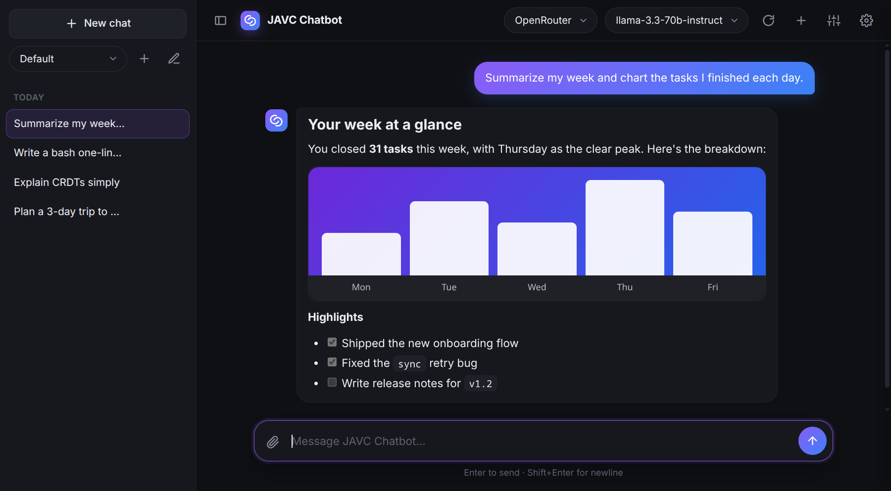

<div align="center">


# JAVC Chatbot

**A fast, private client for any OpenAI-compatible API, on Linux, Windows and Android.**

[](LICENSE)
[](#download)
[](https://slint.dev/)
[](https://github.com/TheDWz/JAVC-Chatbot/actions/workflows/build.yml)

[Features](#features) · [Download](#download) · [Getting started](#getting-started) · [Privacy](#privacy--security) · [Build from source](#build-from-source)

<br>



</div>

---

## Features

- **Any OpenAI-compatible provider.** OpenRouter, NanoGPT, Venice, OpenAI, or a local server like Ollama or LM Studio. Built-in templates fill in the endpoint for you.
- **Streaming replies.** Answers appear as they're written. Stop at any time and keep what's been generated so far.
- **Live reasoning.** Watch a reasoning model think in real time, and choose how hard it thinks.
- **Connection profiles.** Save several endpoint, key and model combinations and switch between them in one click. Keys are encrypted by your operating system.
- **Personas.** Give the assistant a name, a personality and a system prompt. Each persona keeps its own chat history.
- **Chat history.** Every conversation is saved locally and grouped by persona. You can duplicate a chat to another persona.
- **Attachments.** Drop in text files, PDFs (text is extracted on your machine) or images for vision models.
- **Rich replies.** Full Markdown: headings, tables, task lists and code blocks with a copy button. When a model writes HTML, CSS or JavaScript, it shows as code with a **Preview** button that runs it in a locked-down sandbox window. Markdown, HTML, CSS and JavaScript can each be switched off.
- **Web search.** Let the model look things up with [Linkup](https://www.linkup.so). It decides when to search and answers from the results. Needs a Linkup API key (Settings → Search) and a model that supports tools.
- **Model picker.** Fetch your provider's model list and search it as you type.
- **Themes.** Six accent gradients (Aurora purple-to-blue is the default) or your own two colors, in dark or light mode following your system setting.
- **One settings panel.** Appearance, connection profiles and reply formats in one place, opened from the gear.
- **Phone-ready.** The Android app is the same app, with a layout that fits a phone screen and the back button closing whatever is open.

## Download

Prebuilt packages are produced by [GitHub Actions](https://github.com/TheDWz/JAVC-Chatbot/actions/workflows/build.yml) for every tagged release.

| Platform | Package | Install |
| :-- | :-- | :-- |
| Linux, any distro | `JAVC-Chatbot-<version>.AppImage` | `chmod +x JAVC-Chatbot-*.AppImage && ./JAVC-Chatbot-*.AppImage` |
| Debian / Ubuntu | `javc-chatbot_<version>_amd64.deb` | `sudo apt install ./javc-chatbot_*_amd64.deb` |
| Fedora / RHEL | `javc-chatbot-<version>.x86_64.rpm` | `sudo dnf install ./javc-chatbot-*.x86_64.rpm` |
| Linux, portable | `javc-chatbot-<version>.tar.gz` | Extract and run `./javc-chatbot` |
| Windows 10 / 11 | `JAVC-Chatbot-Setup-<version>.exe` | Run the installer (per-user, no admin needed) |
| Android 8.0 or later | `JAVC-Chatbot-<version>.apk` | Open the file on your phone and allow your browser or file manager to install apps |

> [!NOTE]
> The Windows installer isn't code-signed yet, so SmartScreen may show "Windows protected your PC". Choose **More info → Run anyway**.
> The Linux packages need WebKitGTK 4.1 for the rich-reply preview (`libwebkit2gtk-4.1` on Debian/Ubuntu, `webkit2gtk4.1` on Fedora); the `.deb` and `.rpm` pull it in.
>
> The Android app isn't on the Play Store, so Android asks you to allow installs from the app you open the APK with. It installs over the earlier Android app and keeps its chats and saved keys.
>
> Coming from an earlier desktop version? Settings and chats carry over, but API keys must be typed in again once.

## Getting started

1. **Add a profile.** On first launch, choose a provider template or **Custom**, then paste your API key. Local servers such as Ollama (`http://localhost:11434/v1`) or LM Studio (`http://localhost:1234/v1`) don't need a key.
2. **Pick a model.** Click the refresh button to fetch the model list, then search and select one.
3. **Chat.** Press <kbd>Enter</kbd> to send and <kbd>Shift</kbd>+<kbd>Enter</kbd> for a new line. Drag files onto the window to attach them.
   On Android, <kbd>Enter</kbd> starts a new line and the send button sends; attach files with the paperclip. A local server on your computer is reached by its network address (for example `http://192.168.1.20:11434/v1` for Ollama started with `OLLAMA_HOST=0.0.0.0`), not `localhost`.

Click the assistant's avatar on any reply to open its reasoning. The sliders button sets the reasoning level. The gear opens **Settings**: pick a theme, manage connection profiles, set up web search, and choose which reply formats (Markdown, HTML, CSS, JavaScript) are shown.

## Privacy & security

- **No telemetry.** The app only talks to the API endpoint you configure. The one exception is web search, which is off until you turn it on: then the queries the model writes are sent to Linkup (linkup.so) with your Linkup key.
- **Encrypted keys.** API keys (including the Linkup key) are encrypted with a key kept in your OS keyring (Secret Service on Linux, Credential Manager on Windows) and are only ever sent to the service they belong to: your provider, or Linkup for the search key. On a Linux desktop with no keyring, the key is stored in a file only your user can read. On Android, keys are encrypted with a key held by the Android Keystore, which never leaves the device.
- **Local data.** Settings and chats are stored in plain files on your machine:
  - Linux: `~/.config/javc-chatbot/`
  - Windows: `%APPDATA%\javc-chatbot\`
  - Android: the app's private storage, which other apps can't read. It's left out of cloud backups, and uninstalling the app deletes it.
  - Settings and chats from an older `chatbot` folder are moved here automatically on first launch.
- **Sandboxed rich content.** Model-written HTML runs only when you open its preview, in a separate window with an isolated, sandboxed frame. It can't see the app, your keys, your chats or your files, and it's denied camera, microphone, location and other permissions. It *can* load resources from the internet, for example chart libraries from a CDN. You can turn HTML, or just its CSS and JavaScript, off in Settings → Replies.
- **No tracking pixels.** Remote images in Markdown are never loaded automatically. They show as links instead.

## Build from source

The app is written in Rust with a [Slint](https://slint.dev/) UI. You'll need stable Rust and, on Linux, the WebKitGTK and GTK development packages (`sudo apt install libwebkit2gtk-4.1-dev libgtk-3-dev libdbus-1-dev libfontconfig1-dev`, or `webkit2gtk4.1-devel gtk3-devel dbus-devel fontconfig-devel` on Fedora).

```bash
git clone https://github.com/TheDWz/JAVC-Chatbot.git
cd JAVC-Chatbot/rust
cargo run       # run the app
cargo test      # run the test suite
```

### Packaging

From `rust/`:

```bash
cargo packager --release --formats appimage,deb   # Linux, into dist/rust/
cargo generate-rpm -o ../dist                     # .rpm
cargo packager --release --formats nsis           # Windows installer (on Windows)
```

- **Continuous integration:** pull requests, pushes to `main`, `v*` tags and manual runs of the **Build packages** workflow build every package on GitHub-hosted runners and attach them to the workflow run. Each run also tests the app: the unit tests, the desktop app's built-in self-test against a mock API, and the Android APK on an emulator (the self-test and the back button).

### Android

`android/` is the Gradle project. A NativeActivity hosts the Slint window, and a little Java handles what needs Android itself: the Keystore, clipboard, file picker, links and the WebView for rich-reply previews. Gradle builds the Rust library with [cargo-ndk](https://github.com/bbqsrc/cargo-ndk) first.

You'll need [JDK 21](https://adoptium.net/), the Android SDK with platform 36 and NDK 28 (`ANDROID_HOME` and `ANDROID_NDK_HOME`), `cargo install cargo-ndk` and `rustup target add aarch64-linux-android x86_64-linux-android`.

```bash
cd android
./gradlew assembleDebug     # or assembleRelease
```

### Release signing

Android only installs an update over an existing app if both are signed with the same key. Without one, CI signs the APK with a throwaway key: it installs, but the next build can't be installed over it without uninstalling first, which deletes the app's chats and settings. Create a key once and keep it safe, since losing it means users have to reinstall:

```bash
keytool -genkeypair -v -keystore javc-release.jks -alias javc -keyalg RSA -keysize 4096 -validity 10000
base64 -w0 javc-release.jks   # on macOS: base64 -i javc-release.jks
```

Then add these repository secrets (**Settings → Secrets and variables → Actions**):

| Secret | Value |
| :-- | :-- |
| `ANDROID_KEYSTORE_BASE64` | the base64 output above |
| `ANDROID_KEYSTORE_PASSWORD` | the keystore password |
| `ANDROID_KEY_ALIAS` | `javc` (or the alias you chose) |
| `ANDROID_KEY_PASSWORD` | the key password (the same as the keystore password unless you set a different one) |

To sign a local build, set the same names as environment variables, with `ANDROID_KEYSTORE_FILE` pointing to the `.jks` file instead of the base64 secret.

### Project layout

| Path | Purpose |
| :-- | :-- |
| `rust/src/core/` | Settings, profiles, personas, chats and the OpenAI-compatible streaming client; no UI |
| `rust/src/app.rs` | The UI controller |
| `rust/ui/` | The Slint UI |
| `rust/src/markdown.rs` / `attach.rs` | Reply rendering, and attachments (text, PDF, images) |
| `rust/src/preview.rs` | The sandboxed rich-reply preview window (desktop) |
| `rust/src/platform.rs` / `android.rs` | Desktop and Android specifics (key encryption, clipboard, files) |
| `rust/selftest/` | The mock API and the scripts for the built-in self-test |
| `android/` | Android project: the activity, the preview WebView and the Gradle build |
| `build/` | App icon and the scripts that generate the desktop and Android icons |

More detail, including the self-test, is in [`rust/README.md`](rust/README.md).

## License

JAVC Chatbot is free software, released under the [GNU General Public License v3.0 or later](LICENSE).

<div align="center">
<sub>© TheDWz</sub>
</div>
